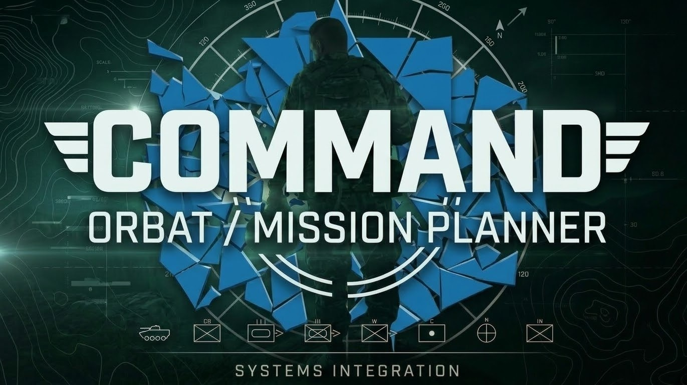

# COMMAND — ORBAT / Mission Planner

COMMAND ORBAT / Mission Planner and the optional Arma Reforger bridge.

Current published release candidate: **2.9.1-rc.2**. Includes offline planning, scenario/property workflows, reviewed asset catalogs, display diagnostics and experimental dedicated-server integration. Planner code is in [`planner/`](planner/). Published versions retain matching tags and source archives.

## Download

[Download 2.9.1 Release Candidate 2](https://github.com/GrimActual/COMMAND-ORBAT-Mission-Planner/releases/tag/v2.9.1-rc.2-command).

[Browse all releases](https://github.com/GrimActual/COMMAND-ORBAT-Mission-Planner/releases). Historical builds retain their original versions. Experimental builds and release candidates are marked as prereleases.

## Run from source

Use Node.js, open `planner/`, run `npm install`, then `npm start`. Run `npm test` where a test script exists. For one-click bridge builds, copy `bridge-runtime/cloudflared.exe` from the matching Windows application resources or use the complete source release ZIP; the portable executable is not committed to Git. See the component license notices in the source.

## Scope

This is an independent community planner, not an official Bohemia Interactive product. Live bridge support is optional, shares one host-controlled character and requires the companion mod. Simulation uses synthetic data. See each release for its actual capabilities and limitations.

## Live bridge quick start

1. In the planner, open Settings → Live bridge → Start free connection.
2. In Reforger with the companion mod enabled, open COMMAND – HOST PAIRING.
3. Copy the planner address into the game’s first field and the code into its second field; click CONNECT, resume and control a soldier.
4. Keep the planner PC awake. Temporary tunnel addresses change; public codes expire after one hour.

Simulation is a separate practice feature. Current RC2 has been user-tested in-game but remains labelled a release candidate. The prior stable release is v2.8.2.

[Release history](RELEASES.md) · [Latest debrief](planner/RELEASE-DEBRIEF.md)

## v2.9.1 development preview

This development branch adds experimental dedicated-server profiles and a single-entity sender candidate. See [setup](docs/DEDICATED-SERVER.md), [audit](docs/V2.9.1-AUDIT.md), and [preview notes](docs/V2.9.1-RELEASE-NOTES.md). Enfusion compilation and real dedicated hosting remain validation gates. Existing published downloads are unchanged.

## Future programme

[Master roadmap](ROADMAP.md) · [200-feature wishlist](docs/FUTURE-FEATURE-WISHLIST.md). Sixteen packages ordered by dependencies; no delivery dates. The next integrated architectural milestone is an offline JSON-driven GM scenario.

Development 11: [reviewed prefab planning assets](docs/REVIEWED-PREFAB-ASSETS.md) connects Workbench metadata review to unit asset assignment, with explicit classification and retained provenance. Available in the development executable; Preview 5 archives are unchanged.

Development 12 adds [portable planning catalog export](docs/PORTABLE-PLANNING-CATALOGS.md) for reuse after restart, retaining assigned asset provenance without changing mission state. Available in the development executable; existing Preview 5 archives are unchanged.

Development 13 adds [downloaded-addon project identity review](docs/PROJECT-IDENTITY-COMPATIBILITY.md), accepting opaque project configuration blocks without inferring prefab GUIDs. Available in the development executable; Preview 5 archives remain unchanged.

Development 14 adds [resource index reuse in Assets](docs/RESOURCE-INDEX-REVIEW-UI.md), with worker-backed JSON loading, multiple-addon review and cached dependency findings. Available in the development executable; Preview 5 archives remain unchanged.

Native read-only bridge [diagnostic runtime gate](docs/NATIVE-BRIDGE-RUNTIME.md) passed real Enforce-to-HTTPS-to-Companion position and authentication checks. Same-session interval reload is fixed in the dedicated candidate. A bounded standalone dedicated-server HTTPS movement test also passed; The user confirmed Workshop 0.2.0 publication; testing the downloaded Workshop package remains separate. Preview 5 archives are unchanged.

Notice & Disclaimer:

This project is an unofficial community-made companion tool for Arma Reforger. It is not affiliated with, endorsed, sponsored, or specifically approved by Bohemia Interactive a.s.

Arma Reforger, Enfusion, and Bohemia Interactive are trademarks or registered trademarks of Bohemia Interactive a.s.

COMMAND is an independent community project. This branding update preserves saved plans and the existing Workshop addon identity. Historical branding editions retain their own feature versions and limitations.
